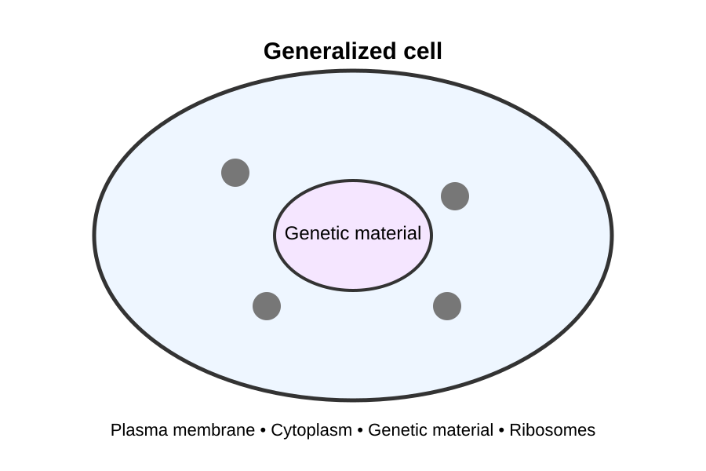

# Cell Biology

## Introduction

Cells are the fundamental units of living organisms.

Although cells vary enormously in structure and function,
all cells share several fundamental characteristics.

## Learning objectives

By the end of this chapter, you should be able to:

- explain the main principles of cell theory
- distinguish between prokaryotic and eukaryotic cells
- identify major cellular structures
- relate cellular structure to cellular function
- explain why cells must remain relatively small

## 1.1 Cell theory

Cell theory provides a fundamental framework for understanding
biology.

The modern version of cell theory includes several key ideas:

1. All living organisms are composed of one or more cells.
2. The cell is the basic structural and functional unit of life.
3. Cells arise from pre-existing cells.

These principles provide a foundation for understanding the
organization of living systems.

::: {.callout-tip}
## Biology tip

When studying cell biology, don't memorize structures in
isolation.

Always ask:

**How does the structure of a cell or organelle help it
perform its function?**
:::

## 1.2 Cell organization

Cells contain structures that work together to maintain
the organization and processes necessary for life.

{#fig-cell-organization}

@fig-cell-organization shows a simplified
representation of cellular organization. The structures
within a cell work together as an integrated system.

## Prokaryotic and eukaryotic cells

Cells can be broadly classified as prokaryotic or eukaryotic.

### Prokaryotic cells

Prokaryotic cells do not have a membrane-bound nucleus.

Bacteria are examples of organisms whose cells are
prokaryotic.

### Eukaryotic cells

Eukaryotic cells contain a nucleus surrounded by a membrane.

Animals, plants, fungi, and protists contain eukaryotic cells.

## Check your understanding

### Question 1

Which structure contains most of the genetic material in a
typical eukaryotic cell?

- Ribosome
- Nucleus
- Cell wall
- Mitochondrion

::: {.callout-note collapse="true"}
## Answer

**Nucleus**

In a typical eukaryotic cell, most of the cell's DNA is
contained within the nucleus. The nucleus is surrounded by
a nuclear envelope that separates its contents from the
cytoplasm.

Mitochondria also contain a small amount of DNA, which is
why the phrase "most of the genetic material" is important.
:::

### Question 2 — Explain your reasoning

A student says:

> "Mitochondria can't contain DNA because DNA is only found
> in the nucleus."

Is the student's statement correct?

::: {.callout-note collapse="true"}
## Answer

No.

Mitochondria contain their own small amount of DNA. However,
the vast majority of a eukaryotic cell's DNA is located in
the nucleus.

This is an example of why biological statements need to be
interpreted carefully. Saying that DNA is "in the nucleus"
is useful as a generalization, but it is not literally true
for every DNA molecule in a eukaryotic cell.
:::

::: {.callout-tip}
## Think about it

Why might it be useful for a cell to keep most of its DNA
inside a membrane-bound nucleus?

Think about what the nucleus separates from the rest of
the cell.
